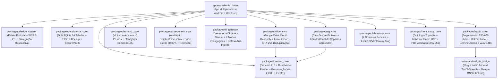

# Arquitetura de Software — Academia Forense (Laboratório de Formação)

**Data:** 16/11/2026  
**Versão:** 1.0.0  
**Plataformas Alvo:** Android (Mobile-first, Samsung Galaxy A57) e Windows Desktop (Notebook 16 GB RAM)  
**Idioma:** Português Brasileiro (`pt-BR`)

---

## 1. Visão Geral e Princípios Arquiteturais

A **Academia Forense — Laboratório de Formação** foi projetada como um monorepo modular em **Flutter / Dart 3.5+**, integrado a uma ponte nativa **Kotlin Android (`android_tts_bridge`)** para síntese neural local via **Sherpa-ONNX / Kokoro (Braseiro)** e persistência relacional **SQLite + FTS5 (`Drift`)**.

### Princípios Estruturais Inegociáveis
1. **Isolamento de Domínio em 11 Pacotes + 1 Plugin Nativo + 1 App Principal**: Cada subsistema possui fronteiras claras, contratos explícitos e suíte de testes independente.
2. **Motor de Conteúdo Versionado e Incremental (§2 e §19)**: Nenhum capítulo, volume ou exercício é fixado de maneira rígida no código da UI. O catálogo opera sobre o manifesto canônico (`content/manifests/curriculum.manifest.json`) com 9 volumes e 113 capítulos e pacotes validados pelo JSON Schema da Seção 19 (`content/schemas/section_19_schema.json`).
3. **Preservação Estrita dos Dados do Estudante (§2.2 e §20)**: Atualizações de capítulos verificadas por hash SHA-256 jamais sobrescrevem anotações, destaques, notas de avaliações (corte de 80%), favoritos ou submissões laboratoriais. Quando uma âncora textual (`anchorKey`) desaparece em uma nova revisão, o motor de anotações marca `isOrphaned = true` com aviso explícito ao aluno, preservando integralmente o texto da nota.
4. **Proibição de Fallback Silencioso entre Motores de Voz (§11.6 e §12.4)**: Quando o usuário seleciona `Braseiro Kokoro — Local`, o sistema utiliza exclusivamente a ponte nativa Android (`com.k2fsa.sherpa.onnx.tts.engine` / `.debug`); quando seleciona `Gemini TTS — Online`, utiliza exclusivamente a API Gemini com a voz `Charon`. Falhas em qualquer motor são reportadas com diagnóstico claro, sem troca oculta.
5. **Rigor Epistemológico no Tutor IA e nos Estudos de Caso (§9.3 e §15.2)**: O tutor RAG separa obrigatoriamente `[FONTE: ...]`, `[INFERÊNCIA DO TUTOR]`, `[CONHECIMENTO COMPLEMENTAR]` e `[EXERCÍCIO HIPOTÉTICO]`, bloqueando capítulos em status `Planejado` ou `Em revisão`. Nos estudos de caso, o validador exige a separação tripartite entre **Fato Documentado**, **Inferência Investigativa** e **Hipótese Alternativa**.

---

## 2. Topologia do Monorepo

---

## 3. Banco de Dados Relacional e Persistência (`packages/persistence_core`)

O banco de dados local utiliza **SQLite 3 com Drift** e suporta todas as **24 entidades obrigatórias da Seção 20.1**, além da tabela virtual **FTS5 (`fts_content_index`)** para busca textual instantânea com suporte a diacríticos do português brasileiro:

1. `volumes`
2. `chapters`
3. `chapter_revisions`
4. `lessons`
5. `sections`
6. `assets`
7. `references_table`
8. `glossary_terms`
9. `exercises`
10. `exercise_attempts`
11. `assessments`
12. `assessment_results`
13. `annotations` (com `anchorKey`, `revisionId` e flag `isOrphaned`)
14. `highlights`
15. `bookmarks`
16. `study_sessions`
17. `study_plans`
18. `competency_scores`
19. `lab_tasks`
20. `lab_submissions`
21. `case_studies`
22. `case_submissions`
23. `ai_conversations`
24. `audio_cache` (com controle LRU e metadados de motor/voz/velocidade)
25. `sync_history`
26. `settings`

---

## 4. Design System Editorial e Responsividade (`packages/design_system`)

- **Paleta Editorial Obrigatória (§5.1)**:
  - Fundo principal: `#F5F6F3`
  - Superfícies e cartões: `#FFFFFF`
  - Verde floresta principal: `#20533F`
  - Verde floresta escuro: `#163D2E`
  - Verde secundário: `#347259`
  - Verde claro: `#E7F0EA`
  - Texto principal: `#26322C`
  - Texto secundário: `#66736B`
  - Bordas: `#E1E6E0`
  - Fundo suave de campos: `#F0F2EF`
- **Acessibilidade**: Contraste verificado matematicamente segundo a fórmula de luminância relativa WCAG 2.1 (`AccessibilityTokens.contrastRatio`), alvos de toque mínimos de `48x48 dp` e escalonamento tipográfico seguro até `1.6x` sem truncamento ou overflow no viewport do **Samsung Galaxy A57 (`412x915 dp`)**.
- **Navegação Dual (§5.2)**: Barra inferior de 5 abas (`Início`, `Estudar`, `Biblioteca`, `Laboratório`, `Meu Espaço`) em dispositivos móveis (`width < 800 dp`) e `NavigationRail` lateral expansível no Windows Desktop (`width >= 800 dp`).
